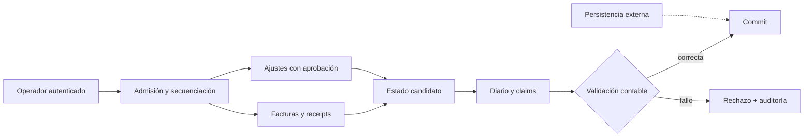

# Seguridad De Sable DTL

## Modelo De Seguridad

Sable DTL asume un entorno de ejecucion controlado donde los operadores cargan
facturas, receipts, ajustes y cierres mediante procesos autenticados fuera del
binario. El motor protege las invariantes economicas internas con tipos fuertes,
journal balanceado, politicas de ajuste, digests deterministas y tests de
escenarios.



## Invariantes Esperadas

- Todo journal debe tener debitos y creditos iguales.
- Toda cuenta usada por un journal debe existir en el chart activo.
- Los receipts aplicados deben tener importe positivo y referencia de invoice.
- Los ajustes manuales deben respetar los limites de basis points configurados.
- Los ajustes que requieren aprobacion dual deben llevar aprobador distinto al
  flujo operativo normal.
- Los close batches deben producir un trial balance balanceado.
- Los reportes de escenario deben producir digests reproducibles.
- Los claims de settlement deben mantener estado explicito: prepared, posted,
  settled, frozen o cancelled.
- Un lote de claims rechazado no puede dejar asientos ni estados `Posted`
  parciales en memoria.
- Las facturas emitidas requieren referencia externa, líneas positivas y
  vencimiento representable.

## Validaciones Automatizadas

La suite Rust compila el binario, ejecuta tests unitarios de cantidades y valida
escenarios CLI. La suite JavaScript ejecuta el binario como consumidor externo y
verifica pagos validos, importacion de receipts, ajustes aprobados, cierre
mensual y reconciliacion final.

Comandos:

```bash
cargo test --locked
node --test tests/node/*.test.js
bash scripts/ci.sh
```

## Gestion De Dependencias

El proyecto usa un conjunto pequeno de dependencias:

- `serde` y `serde_json` para reportes y serializacion canonica.
- `blake3` para digests deterministas.
- `thiserror` para errores de dominio.

Dependabot revisa Cargo, npm y GitHub Actions de forma semanal.

## Alcance De Revision

Estan dentro de alcance:

- `src/adjustments`
- `src/invoice`
- `src/ledger`
- `src/settlement`
- `src/close`
- `src/runtime`
- tests Rust y JavaScript
- scripts y workflow de CI

Fuera de alcance:

- Integraciones bancarias reales.
- Firmas de operador o autenticacion externa.
- Persistencia en base de datos.
- Redes de pago reales.

Un trial balance balanceado prueba igualdad contable agregada. No valida por
sí solo la elegibilidad de cada contraparte ni la autorización comercial de
cada claim. El integrador debe realizar esas revisiones por referencia,
factura y lote antes de transmitir pagos fuera del motor.

## Reportes Internos

Un reporte interno debe incluir:

- resumen ejecutivo;
- impacto economico;
- ruta de reproduccion;
- ubicacion exacta;
- causa raiz;
- mitigacion directa;
- tests recomendados;
- evidencia de comando y salida.

No incluir claves, datos de produccion ni informacion bancaria real en issues,
logs o artefactos de CI.
