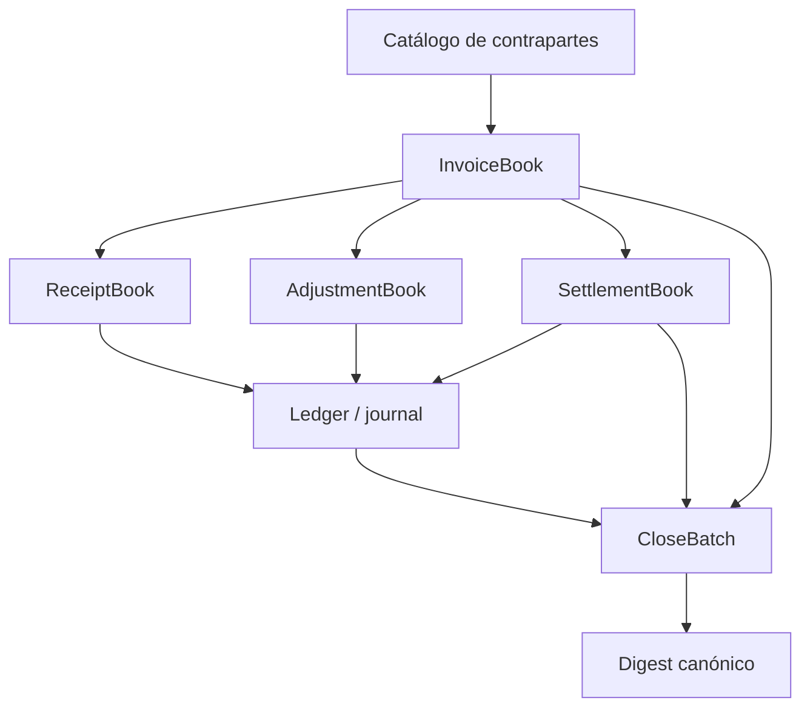

# Arquitectura de conciliación

Sable DTL procesa facturas, cobros, ajustes, claims y cierres en un estado
determinista. El binario expone escenarios JSON para consumo por otra
aplicación. No implementa red de pagos, almacenamiento duradero ni control de
acceso: esas capas se sitúan fuera del motor.

## Contratos por módulo

- `invoice`: identifica obligación, fechas, líneas, impuestos y estado.
- `receipts`: registra procedencia, canal, matching y contabilización de un
  cobro recibido.
- `adjustments`: aplica credit/debit memos con política y aprobaciones.
- `settlement`: prepara claims vencidos, evita duplicados activos y publica
  asientos en lote.
- `ledger`: mantiene chart of accounts, journal y trial balance.
- `close`: concentra métricas de periodo, estado de cierre y digest.
- `codec`: serialización canónica para comparar reportes reproducibles.

## Fronteras de atomicidad

`SettlementBook::post_claims` trabaja sobre copias candidatas del book y del
ledger. Solo reemplaza ambos cuando todas las entradas se han procesado.
Esto evita un lote con claims `Posted` y asientos parcialmente aplicados por
un error intermedio. La garantía es local a memoria; un servicio debe
persistir el par ledger/book dentro de una transacción duradera.

El cierre mensual es una vista preparada de facturas, receipts, claims y
trial balance. Un digest permite detectar diferencias de serialización, pero
no sustituye la procedencia de los archivos de cobro ni una aprobación humana
del cierre.
