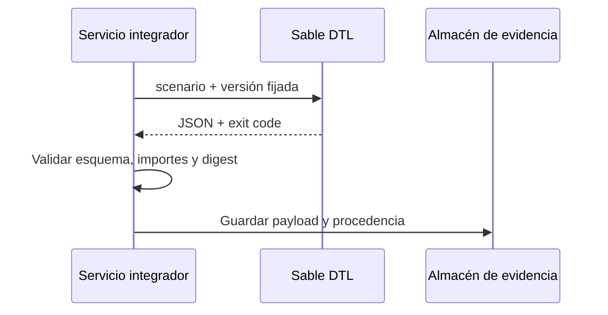

# Integración de la CLI

El binario acepta un nombre de escenario y emite un objeto JSON por stdout.
Una ejecución correcta termina con código cero. Un error de argumento o de
dominio debe tratarse como rechazo, no como un reporte financiero parcial.

```bash
cargo run --locked --quiet -- final
```

Los escenarios disponibles son `valid`, `receipts`, `adjustments`,
`monthly-close` y `final`. No reciben archivos bancarios ni ejecutan pagos;
los datos son deterministas y sirven para verificar el contrato de salida.

## Campos del reporte

| Campo | Uso |
| --- | --- |
| `scenario`, `day` | Identidad y fecha lógica del proceso |
| `invoice_rows` | Estado e importes por factura |
| `claim_rows` | Claims y estado de publicación |
| `ledger` | Número de asientos y equilibrio contable |
| `settlement` | Totales de obligaciones y claims |
| `close` | Corte de periodo, si existe |
| `digest` | Compromiso determinista del reporte |

La integración debe convertir `Money.cents` a una representación decimal
exacta, conservar el JSON original y registrar versión del binario, digest y
parámetros de invocación. No se recomienda reinterpretar `day` como timestamp
UTC; es un día lógico de escenario.



Las operaciones reales de admisión, conciliación de archivos externos y
aprobación humana no están implementadas por esta CLI. Deben ser transacciones
separadas en el servicio anfitrión.
