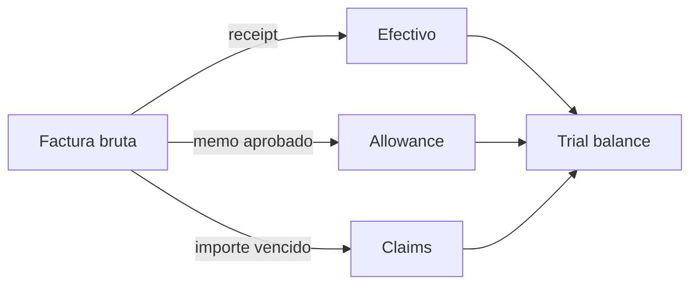

# Modelo económico y contable

`Money` representa centavos enteros (`i64`). Un importe mostrado como
`1.350,00` se serializa con `cents = 135000`. Los basis points (`Bps`) usan
denominador 10.000 y el cálculo porcentual redondea al centavo más cercano.
No deben introducirse importes en coma flotante en conectores externos.

## Factura y asientos

Para cada línea `i`:

```text
neto_i = cantidad_i × precio_unitario_i
impuesto_i = redondear(neto_i × tax_bps_i / 10_000)
total_factura = Σ neto_i + Σ impuesto_i
```

Una factura de 10.000,00 con impuesto de 8 % tiene base de 10.000,00,
impuesto de 800,00 y total de 10.800,00. La emisión crea una cuenta por cobrar
y su contrapartida de ingresos. Un receipt reduce la cuenta por cobrar y
aumenta efectivo. Un credit memo aprobado reduce la obligación contable y
registra su contrapartida de allowance.

## Ejemplo de conciliación

| Concepto | Importe |
| --- | ---: |
| Factura emitida | 54.000,00 |
| Receipts aplicados | 51.300,00 |
| Credit memos aprobados | 2.700,00 |
| Saldo contable | 0,00 |

Los reportes separan métricas de factura, journal y settlement para que cada
consumidor aplique su propio corte temporal. Un reporte agregado no reemplaza
la revisión del expediente de cada invoice y sus documentos de soporte.



La igualdad `total_debits = total_credits` es una invariante de partida doble.
Debe acompañarse de controles por referencia externa, contraparte y
correspondencia documental; por sí sola no establece que un pago individual
sea correcto.
