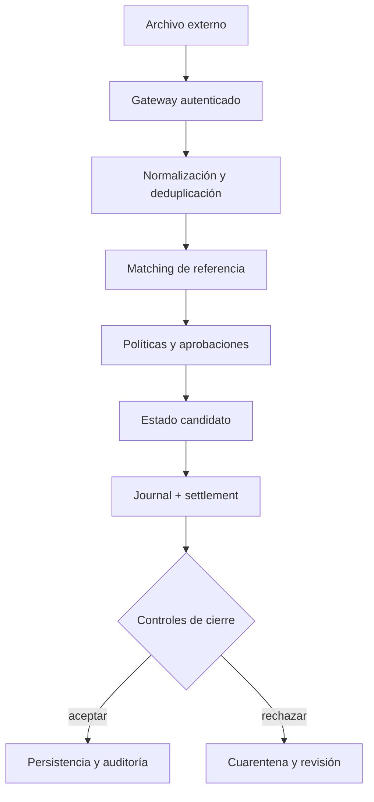

# Seguridad operativa

El motor asume procesos de importación autenticados. No verifica firmas de
bancos ni custodia claves: esos controles pertenecen a la capa de integración.
Se debe tratar toda factura, receipt y ajuste entrante como dato no confiable.

## Controles por fase

- **Admisión:** tamaño máximo, esquema y referencia externa obligatoria;
  rechazar fechas fuera de rango y líneas no positivas.
- **Matching:** conservar identificadores de origen y evitar aplicar el mismo
  receipt dos veces en el servicio anfitrión.
- **Ajustes:** exigir justificante, aprobador independiente y evidencia de
  política aplicada.
- **Publicación:** tratar book y ledger como una unidad atómica; no transmitir
  un lote parcialmente publicado.
- **Cierre:** comparar detalles por factura y claim además de agregados.

## Incidencias

Si un claim, receipt o ajuste no coincide con su expediente, congelar su
transmisión externa y conservar el JSON de entrada, el digest, el journal, la
versión exacta y el motivo de rechazo. La igualdad del trial balance es un
control necesario, pero no prueba autorización de un pago concreto.

Los reportes sensibles deben seguir el canal privado indicado en
[SECURITY.md](../SECURITY.md); no adjuntar datos bancarios o claves a issues
públicas.
